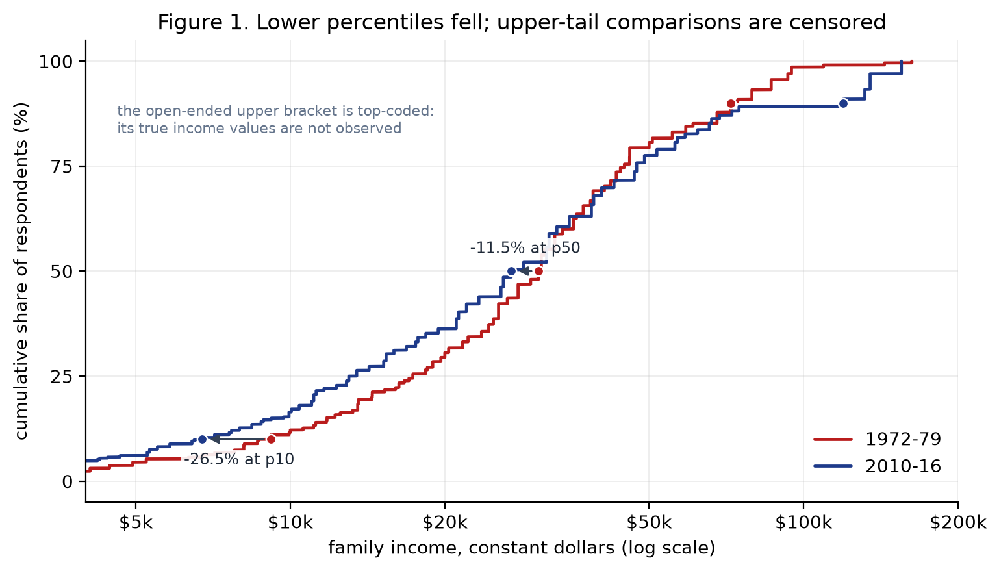
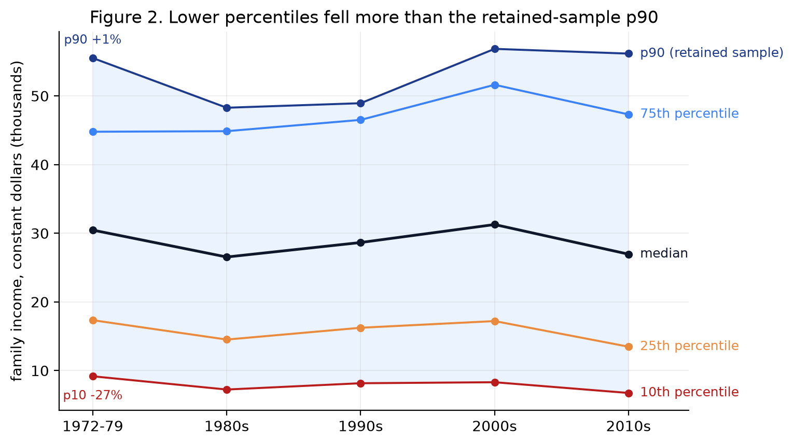
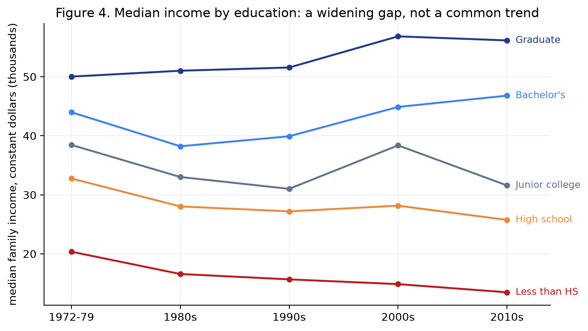

# A widening divide, with losses at the bottom

**A reproducible analysis of U.S. family income, 1972–2016**

This project uses 55,343 General Social Survey (GSS) respondents to examine how the income
distribution changed over four decades and how median trends differed by highest degree. It is a
descriptive analysis: it does not claim that education caused the changes.



## Research question

Between 1972 and 2016, did U.S. family incomes grow, stagnate, or spread apart — and how did
median income trends differ by highest degree?

A median alone cannot answer the first part. It summarises the centre of a distribution but not
what happened below or above it, so this project compares several quantiles and dispersion measures.

## Data and scope

| Item | Description |
|---|---|
| Source | General Social Survey (GSS), NORC at the University of Chicago |
| Coverage | 31 survey waves, 1972–2016; income refers to the year before interview |
| Unit | One respondent per row; the outcome is family income, not individual earnings |
| Analytical sample | 55,343 respondents after the documented validity filters |
| Variables | Survey year, schooling years, highest degree, real family income, person weight |
| Income unit | Constant 1986 U.S. dollars (`realinc`), already deflated by the GSS |
| Local data | `data/gss_income.csv` — five columns, approximately 1.4 MB |
| Provenance | [`data/README.md`](data/README.md), including construction and reuse notes |

The reduced public-use extract contains no direct identifiers or restricted variables. It is
included for teaching and reproducibility; the underlying GSS data remain subject to NORC's terms.

## Method

**Tools.** Python, pandas, NumPy and Matplotlib. The statistics are calculated explicitly in the
notebook so that the arithmetic can be inspected.

1. **Survey weights.** Descriptive statistics use `wtssall`. Weighted quantiles interpolate on
   cumulative mid-weights rather than treating every row as equally likely.
2. **Constant dollars.** `realinc` is expressed in constant 1986 dollars. No second deflation is
   applied. Percentage changes compare the pooled periods 1972–1979 and 2010–2016.
3. **Top-coding.** The open-ended upper income bracket is assigned a single value. Depending on the
   period, 7.4–11.3% of sampled observations sit at their survey year's maximum. Headline tail
   statistics therefore use the retained, non-top-coded sample. The reported p90 is the 90th
   percentile **of that retained sample**, not an estimate of the full-population p90.
4. **Sensitivity check.** The notebook also calculates Gini and log-income dispersion without
   trimming. The upward direction remains, but the levels differ; neither specification reveals the
   unobserved incomes inside the top bracket.

**Measures.** Weighted p10, p25, median, p75 and retained-sample p90; p75/p25; weighted Gini from
the Lorenz curve; standard deviation of log income; share below 60% of the period median; and
weighted median income by highest degree.

## Key findings



1. **Lower incomes lost substantial ground.** Between 1972–1979 and 2010–2016, p10 fell from about
   \$9,200 to \$6,700 (−26.5%), p25 fell 22.3%, and the median fell 11.5%, all in constant dollars.
2. **The retained-sample upper quantile was nearly unchanged.** The non-top-coded p90 moved +1.2%.
   This is not evidence about the highest earners, whose incomes are censored.
3. **Dispersion increased.** The p75/p25 ratio rose from 2.58 to 3.51. In the retained sample, the
   Gini rose from 0.33 to 0.38 and SD of log income from 0.77 to 1.00. The share below 60% of the
   period median rose from 25.5% to 31.2%.
4. **Education groups had different descriptive trends.** Median income fell 33.8% for respondents
   without a high-school diploma and 21.4% for high-school graduates, but rose 6.4% for bachelor's
   and 12.3% for graduate respondents. The bachelor's-to-high-school median ratio rose from 1.34 to
   1.82. These comparisons do not isolate a causal education effect.



## Limitations

- **Top-coding censors the upper tail.** Trimmed results describe only the retained sample; they are
  not unbiased full-population inequality estimates. The sensitivity check supports the direction of
  the trend, not the exact magnitude.
- **Repeated cross-sections are not a panel.** The same households are not followed over time, and
  changes in sample composition can contribute to differences between periods.
- **Family income is not equivalised.** Household size is not available in this five-variable
  extract, so the analysis does not adjust for differences in household needs.
- **Validity filters may not be random.** The extract retains 88.6% of upstream rows after all
  filters. If exclusion is related to income, the estimates may be biased.
- **No causal or design-based uncertainty claims.** Education is a grouping variable, and the extract
  does not contain the strata/PSU variables required for full survey-design standard errors.
- **The period ends in 2016.** The results do not describe later income changes.

## Repository contents

```text
data-science-project/
├── income_analysis.ipynb        # analysis, outputs, validation checks and figures
├── figures/                     # four PNG files regenerated by the notebook
├── data/
│   ├── gss_income.csv           # the analysed extract
│   └── README.md                # provenance, construction and reuse notes
├── requirements.txt             # exact tested package versions
├── LICENSE                      # MIT licence for the original code and text
└── README.md
```

## Reproduce the analysis

The repository is self-contained; no separate data download is required.

```bash
git clone https://github.com/wangtingyue0322-beep/data-science-project.git
cd data-science-project
python -m venv .venv
```

Activate the environment:

```bash
# macOS / Linux
source .venv/bin/activate

# Windows PowerShell
.venv\Scripts\Activate.ps1
```

Then install the tested dependencies and open the notebook:

```bash
python -m pip install -r requirements.txt
jupyter lab income_analysis.ipynb
```

Choose **Run → Run All Cells**. The notebook checks the input schema and values, recomputes every
quoted statistic, and rewrites all four figures under `figures/`.

**Tested environment:** Python 3.13.13, pandas 3.0.3, NumPy 2.3.5, Matplotlib 3.11.0 and
JupyterLab 4.5.8. Exact package versions are recorded in `requirements.txt`.

## Status and next step

**Completed and reproducible.** A future extension could add household size, survey-design variables
and later GSS waves to address several limitations without changing the core workflow.

## Author and licence

Analysis and text by **Wang Tingyue (WANGTINGYUE)**. Original code and text are released under the
MIT licence; see [`LICENSE`](LICENSE). The underlying GSS data remain subject to NORC's terms and
citation requirements; see [`data/README.md`](data/README.md).
