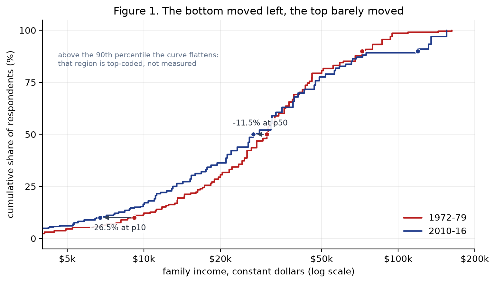
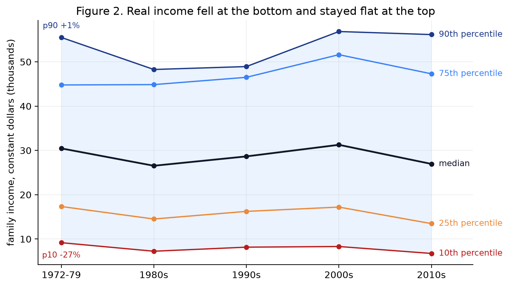
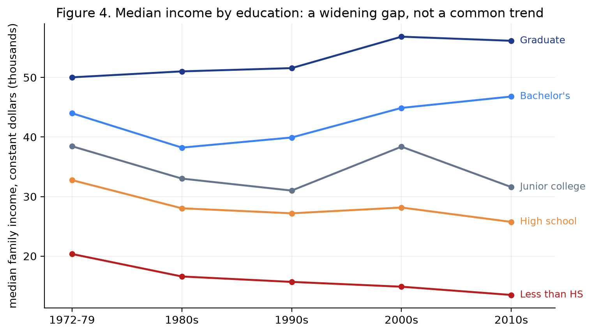

# Growth at the top, erosion at the bottom

**How the distribution of U.S. family income moved between 1972 and 2016**

A reproducible analysis of 55,343 General Social Survey respondents asking whether American family
incomes grew, stagnated, or spread apart over four decades — and how much of the change is
accounted for by education.



---

## The question

The headline U.S. income series is usually quoted as a single number, the median. A median says
nothing about the shape of the distribution around it. If the bottom falls while the top is flat, a
"stagnant median" is not the absence of change — it is a redistribution.

**Research question:** between 1972 and 2016, did U.S. family incomes grow, stagnate, or spread
apart, and how much of the change is accounted for by education?

## Data

| | |
|---|---|
| Source | General Social Survey (GSS), NORC at the University of Chicago |
| Coverage | 31 survey waves, 1972–2016 |
| Unit | one respondent per row, family income in constant dollars (`realinc`) |
| Sample | 55,343 respondents with a valid income value and a valid degree level |
| File in this repository | `data/gss_income.csv` (5 columns, 1.4 MB) |
| Provenance and reuse terms | [`data/README.md`](data/README.md) |

The GSS is a public-use survey: the data are distributed free of charge by NORC for research and
teaching, and redistributing this five-variable subset for reproducibility falls within those terms.
The extract contains **no direct identifiers and no restricted variables** — only the survey year,
years of schooling, degree level, deflated family income, and the survey weight. Full terms and the
exact construction steps are in [`data/README.md`](data/README.md).

## Methods and tools

**Tools.** Python 3.13 with pandas, NumPy and Matplotlib. No modelling library is needed; every
statistic is computed explicitly so the reader can audit the arithmetic.

**Three methodological choices drive every number:**

1. **Survey weights.** GSS samples are not self-weighting, so all statistics use `wtssall` with a
   weighted quantile that interpolates on cumulative mid-weights. Unweighted aggregates would
   over-represent over-sampled groups.
2. **Constant dollars.** `realinc` is already deflated by the GSS, so a 1972 dollar and a 2016
   dollar are the same unit and no further adjustment is applied.
3. **Trimming the top code.** The income question is bracketed and the open-ended top bracket is
   assigned a single value, which absorbs 7–11% of respondents per period — enough that an
   unadjusted 90th percentile lands *inside* the censored mass. All tail statistics (p90, Gini,
   SD of log income) are therefore computed after dropping observations sitting on their survey
   year's ceiling. Medians and lower quantiles use the full sample.

**Measures.** Weighted quantiles (p10–p90), the p75/p25 ratio, the Gini coefficient from the
weighted Lorenz curve, the standard deviation of log income, the share below 60% of the decade
median, and median income by degree level.

## Key findings



1. **The bottom lost ground.** The 10th percentile fell from about \$9,200 to \$6,700 in constant
   dollars (−26.5%) and the 25th percentile fell 22.3%, while the median fell 11.5%.
2. **The top held rather than gained.** The 90th percentile, measured after trimming the censored
   top code, moved +1.2% over four decades.
3. **The gap widened.** The p75/p25 ratio rose from 2.58 to 3.51, the Gini from 0.33 to 0.38, the
   SD of log income from 0.77 to 1.00, and the share below 60% of the decade median from 25.5% to
   31.2%.
4. **Education separates the trends.** Median income fell 33.8% for respondents without a
   high-school diploma, was roughly flat for high-school graduates (−21.4%), and rose for
   bachelor's (+6.4%) and graduate (+12.3%) respondents. The bachelor's-to-high-school premium
   widened from 1.34 to 1.82.



## One limitation

**The income variable is top-coded, so every inequality measure here is a lower bound.** Each survey
year caps income at a single value that absorbs 7–11% of respondents; those observations are
censored, not observed. Trimming the cap keeps the comparison honest across periods, but it also
removes exactly the observations that would raise the Gini, the p90 and the SD of log income. The
*direction* of the result does not depend on this choice — the trend survives with or without the
trim — but the *magnitude* does, and the true level of inequality is higher than any figure reported
here.

Other caveats worth recording: these are repeated cross-sections rather than a panel, so decade
differences mix real change with change in who was sampled; `realinc` is family income and is not
equivalised for household size, which fell over the period and biases the comparison in an
unquantified direction; 11.2% of GSS respondents have no valid income value and are excluded, which
is unlikely to be missing at random; and the extract ends in 2016.

## Repository contents

```
data-science-project/
├── income_analysis.ipynb        # the analysis, with outputs and figures
├── figures/                     # the four figures, regenerated by the notebook
├── data/
│   ├── gss_income.csv           # the extract analysed here
│   └── README.md                # provenance, construction, reuse terms
├── requirements.txt
└── README.md
```

| Figure | What it shows |
|---|---|
| `fig1_income_cdf_1970s_vs_2010s.png` | Cumulative distribution of income, first period vs last, on a log axis |
| `fig2_income_quantiles_by_decade.png` | Weighted quantiles by decade: the fan opens |
| `fig3_inequality_by_decade.png` | Gini and SD of log income by decade |
| `fig4_median_by_education.png` | Median income by degree level: a widening gap |

## How to run it

The repository is self-contained — the data file is committed, so no download step is required.

```bash
git clone <this-repository-url>
cd data-science-project

python -m venv .venv
source .venv/bin/activate          # Windows: .venv\Scripts\activate
pip install -r requirements.txt

jupyter lab income_analysis.ipynb
```

Then run all cells (`Run` → `Run All Cells`). The four figures are written to `figures/` and the
terminal output reproduces every number quoted above. Full execution takes about 20 seconds.

Tested with Python 3.13.13, pandas 3.0.3, NumPy 2.3.5 and Matplotlib 3.11.0. Earlier versions of all
three work; no deprecated pandas APIs are used.

## Status

Completed. Next step: extend the same framework to equivalised household income and to the
post-2016 waves, which would address the two limitations above.

## Author and licence

Analysis and text by **Wang Tingyue (WANGTINGYUE)**. Code released under the MIT licence; the
underlying GSS data remain subject to NORC's terms of use (see `data/README.md`).
